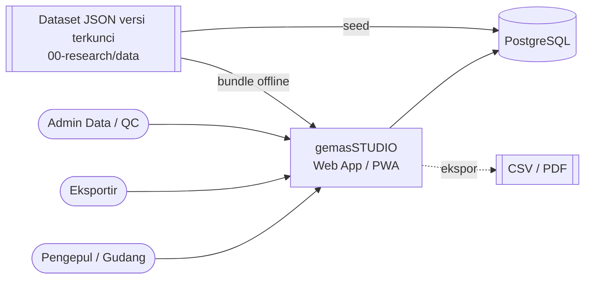
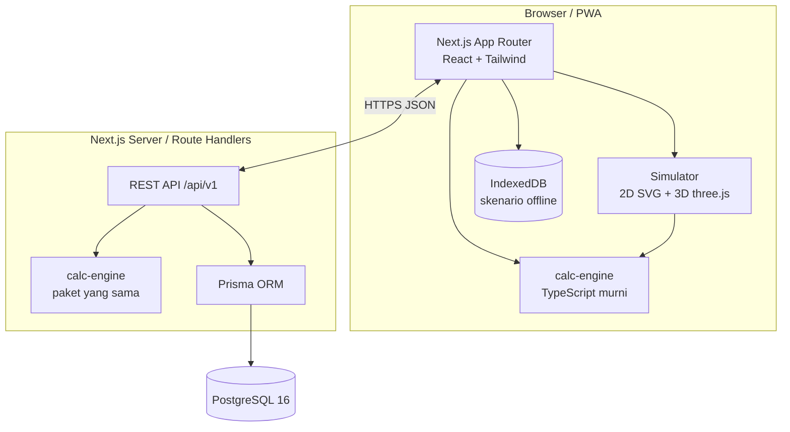
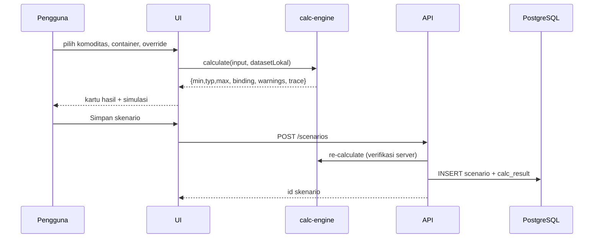

# ARD — Architecture Requirements & Design

## 1. Konteks Sistem (C4 – Level 1)



## 2. Kebutuhan Arsitektur (Architecture Requirements)

| ID | Kebutuhan | Diturunkan dari | Keputusan |
|---|---|---|---|
| AR-01 | Engine kalkulasi deterministik, tanpa I/O, dapat dipakai client & server | NFR-01, NFR-03 | ADR-001 |
| AR-02 | Dataset terversi, immutable per versi, bisa di-override per skenario | NFR-05, FR-11 | ADR-002 |
| AR-03 | Semua nilai fisik direpresentasikan sebagai rentang `{min, typ, max}` | FR-08, US-07 | ADR-003 |
| AR-04 | Satuan internal SI, konversi hanya di lapisan presentasi | NFR-07 | ADR-004 |
| AR-05 | Model muat: densitas efektif + grid kemasan, bukan bin-packing bebas | Non-goal PRD | ADR-005 |
| AR-06 | Audit trail untuk setiap perubahan data referensi | NFR-06 | ERD `AUDIT_LOG` |
| AR-07 | Offline-first untuk kalkulator | NFR-03 | PWA + dataset ter-bundle |

## 3. Container (C4 – Level 2)



## 4. Stack Teknologi

| Lapisan | Pilihan | Alasan |
|---|---|---|
| Monorepo | pnpm workspaces + Turborepo | Engine dipakai bersama web & API |
| Frontend | Next.js 15 (App Router), React, TypeScript, Tailwind | SSR + PWA, ekosistem luas |
| Visualisasi | SVG (2D denah), three.js / @react-three/fiber (3D) | Ringan, interaktif |
| Engine | `packages/calc-engine` TS murni, zero dependency | Deterministik, mudah diuji (ADR-001) |
| Validasi skema | Zod (runtime) + JSON Schema | Dataset & input API tervalidasi |
| DB | PostgreSQL 16 + Prisma | Relasional, JSONB untuk meta |
| Test | Vitest (unit, golden), Playwright (E2E) | Golden cases dari `tests/fixtures` |
| Ekspor | CSV native, PDF via `@react-pdf/renderer` | Tanpa server headless |

## 5. Struktur Repo Target

```
gemas-studio/
├─ apps/web/                  # Next.js (UI + API route handlers)
│  ├─ app/(calc)/             # halaman kalkulator
│  ├─ app/(sim)/              # simulator 2D/3D
│  ├─ app/api/v1/             # REST
│  └─ prisma/schema.prisma
├─ packages/calc-engine/      # ADR-001
│  ├─ src/{range,units,geometry,container,warehouse,moisture,nesting}.ts
│  └─ test/golden.test.ts     # memakai architecture/tests/fixtures/golden_cases.json
├─ packages/dataset/          # salinan JSON + Zod schema + loader
└─ architecture/              # folder ini (sumber kebenaran desain)
```

## 6. Kontrak API (REST v1)

| Method | Path | Fungsi | Body / Query |
|---|---|---|---|
| GET | `/api/v1/datasets/active` | Dataset versi aktif | – |
| GET | `/api/v1/commodities` | Daftar komoditas + parameter | `?version=` |
| GET | `/api/v1/containers` | Daftar container | – |
| POST | `/api/v1/calculate/container` | Kapasitas container | `{commodityId, form, containerId, overrides?, mode}` |
| POST | `/api/v1/calculate/warehouse` | Ruang gudang | `{commodityId, form, massKg \| pieces, stackHeightM, floorUtil, overrides?}` |
| POST | `/api/v1/convert` | Konversi satuan | `{commodityId, from:{unit,value}, to}` |
| POST | `/api/v1/scenarios` | Simpan skenario | `Scenario` |
| GET | `/api/v1/scenarios/:id` | Ambil skenario | – |
| POST | `/api/v1/measurements` | Input sampling lapangan | `Measurement[]` |
| POST | `/api/v1/datasets/:v/proposals` | Usulan kalibrasi (perlu approval) | – |

Format respons hasil (semua endpoint calculate). Nilai `typ` di bawah adalah golden case `jambul_20GP`; `min`/`max` dihitung engine sesuai aturan kombinasi rentang di `calculation_spec.md §2`:

```json
{
  "result": {
    "min": { "pieces": "<engine>", "massKg": "<engine>", "volumeM3": 33.2 },
    "typ": { "pieces": 22230, "massKg": 12782, "volumeM3": 33.2 },
    "max": { "pieces": "<engine>", "massKg": "<engine>", "volumeM3": 33.2 }
  },
  "binding": "VOLUME",
  "confidence": "B",
  "warnings": [],
  "trace": { "datasetVersion": "1.0.4", "params": { "rho_eff": { "value": 385, "source": "dataset", "confidence": "C" } } }
}
```

## 7. Alur Data



Server **selalu menghitung ulang** — hasil dari client tidak dipercaya untuk disimpan (integritas).

## 8. Atribut Kualitas & Taktik

| Atribut | Taktik |
|---|---|
| Kebenaran | Golden cases otomatis dari validator; CI gagal bila engine menyimpang > toleransi |
| Ketertelusuran | Setiap angka hasil membawa `trace` (versi dataset, sumber, keyakinan) |
| Kinerja | Engine O(1) per skenario; grid-fit O(6) orientasi; Monte Carlo dibatasi 5.000 sampel di Web Worker |
| Ketersediaan offline | Service worker cache dataset & engine |
| Keamanan | Auth (NextAuth) hanya untuk simpan & kalibrasi; peran `viewer`, `editor`, `data_admin`; dataset hanya berubah lewat proposal + approval |
| Evolusi | Komoditas baru = tambah entri dataset + (opsional) bentuk geometri baru di engine |

## 9. Penanganan Error & Validasi Input

| Kondisi | Respons |
|---|---|
| Parameter override di luar `[min×0.5, max×2]` | Tolak dengan `422` + pesan rentang wajar |
| Container custom volume ≤ 0 atau payload ≤ 0 | `422` |
| Dataset version tidak dikenal | `404` |
| Kadar air ≥ 100% atau < 0 | `422` |
| Hasil 0 unit (kemasan lebih besar dari container) | `200` + warning `ITEM_EXCEEDS_CONTAINER` |

## 10. Keterlacakan ke Keputusan
Lihat `adr/` dan `logs/decision_log.md`.
