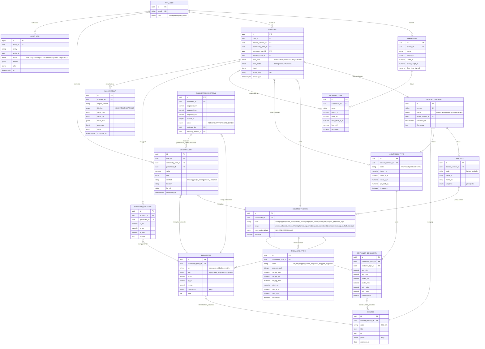

# ERD — Entity Relationship Design

## 1. Diagram

## 2. Aturan Integritas Kunci

| ID | Aturan | Penegakan |
|---|---|---|
| IR-01 | `v_min ≤ v_typ ≤ v_max` dan `v_min > 0` untuk setiap PARAMETER, SCENARIO_OVERRIDE, CALIBRATION_PROPOSAL | `CHECK` constraint |
| IR-02 | DATASET_VERSION berstatus `PUBLISHED` tidak boleh diubah anak-anaknya | Trigger `forbid_published_mutation` |
| IR-03 | Satu `semver` unik; hanya satu versi `PUBLISHED` boleh ditandai aktif | `UNIQUE`, partial unique index `is_active` |
| IR-04 | `(commodity_form_id, key)` unik per form | `UNIQUE` |
| IR-05 | SCENARIO_OVERRIDE.parameter harus milik form yang sama dengan skenario | Trigger `check_override_form` |
| IR-06 | CALC_RESULT hanya ditulis server (engine terverifikasi) | Hak akses: role aplikasi |
| IR-07 | CALIBRATION_PROPOSAL `APPROVED` wajib `sample_n ≥ 10` dan `reviewed_by` peran `data_admin` | `CHECK` + logika aplikasi |
| IR-08 | Semua perubahan entitas referensi & proposal tercatat di AUDIT_LOG | Trigger audit generik |

## 3. Pemetaan Dataset JSON → Tabel

| JSON path | Tabel.kolom |
|---|---|
| `meta.version` | `DATASET_VERSION.semver` |
| `containers[]` | `CONTAINER_TYPE` (cm → m) |
| `commodities[].id` | `COMMODITY.code` |
| `commodities[].geometry.shape` | `COMMODITY_FORM.shape` |
| `commodities[].bulk_density_kg_m3.<form>` | `COMMODITY_FORM.code = <form>` + `PARAMETER(key='bulk_density')` |
| `commodities[].mass_per_unit_g` | `PARAMETER(key='mass_per_unit', unit='kg')` (g → kg) |
| `commodities[].geometry.*_cm.*` | `PARAMETER(key='geometry.<nama tanpa sufiks satuan>', unit='m')` (cm → m) |
| rentang lain (`moisture_pct`, `yield.*`, `*_fraction`) | `PARAMETER` dengan unit `pct` / `count` / `fraction`; sufiks satuan dibuang dari key |

> Catatan normalisasi: parameter tingkat-komoditas (geometri, massa, kadar air) **direplikasi** ke setiap form komoditas tsb; hanya `bulk_density` yang spesifik per form. Implementasi acuan & bukti uji: `scripts/seed_from_dataset.py` → `seed.sql` dimuat bersih ke PostgreSQL 16 (102 parameter, 14 kemasan, 9 benchmark).
| `commodities[].packaging[]` | `PACKAGING_TYPE` |
| `commodities[].container_benchmarks[]` | `CONTAINER_BENCHMARK` + `BENCHMARK_SOURCE` |
| `sources[]` | `SOURCE` |

Form per komoditas (hasil normalisasi):

| Komoditas | COMMODITY_FORM.code | calc_mode_default |
|---|---|---|
| kelapa_jambul | `loose` (ρ tumpukan lepas 483), `bagged` (ρ efektif dalam karung di container 385) | PIECE / PACKAGE |
| arang_batok_belah2 | `halves_loose`, `halves_nested`, `lumps`, `raw_halves` | PIECE / PIECE / BULK / BULK |
| kopra_asalan | `loose_bulk`, `bagged_jute` | BULK |
| kopra_edible | `loose_cups`, `bagged` | BULK / PACKAGE |
