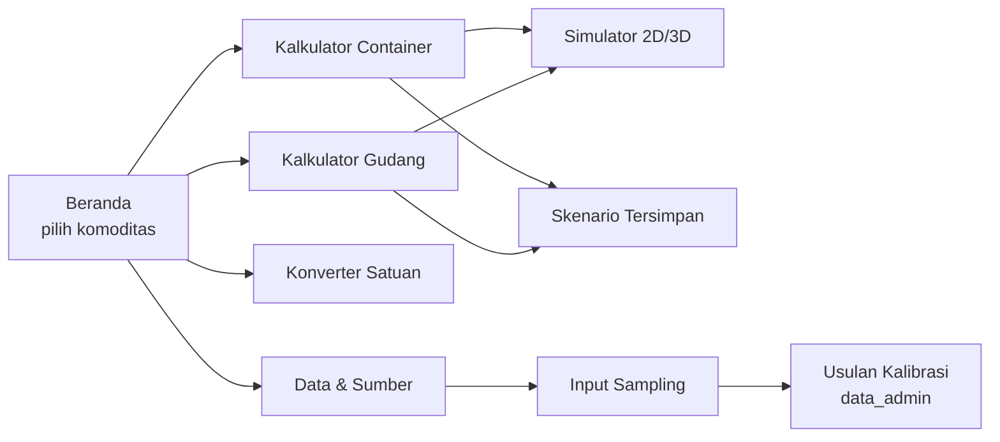

# Spesifikasi UI/UX

## 1. Prinsip Desain

1. **Jawaban dulu, detail kemudian.** Angka `typ` besar di atas; pita min–max dan rincian di bawahnya.
2. **Ketidakpastian terlihat.** Setiap angka membawa badge keyakinan A/B/C; badge C berwarna peringatan + teks "estimasi", bukan warna saja (WCAG).
3. **Batas pengikat jelas.** Label `VOLUME penuh` / `BERAT penuh` dengan ikon, plus bar ganda (isi volume % & isi berat %).
4. **Bahasa gudang.** Pakai istilah lapangan: butir, karung, ton, kontainer, tumpukan; istilah teknis (ρ, φ) hanya di panel "Detail".
5. **Mobile-first** (360 px), target sentuh ≥ 44 px, dapat dipakai satu tangan di gudang.

## 2. Arsitektur Informasi

## 3. Layar Utama

### 3.1 Kalkulator Container
| Area | Isi |
|---|---|
| Input | Komoditas (kartu bergambar 4 pilihan) → Bentuk/kemasan (chip) → Container (20GP/40GP/40HC/Custom) → "Lanjutan" (override parameter, utilisasi) |
| Hasil utama | `22.230 butir` · `12,8 t` · badge `VOLUME penuh` |
| Pita rentang | min ▮▮▮▮▮▮▮▮ typ ▮▮ max, dengan angka di kedua ujung |
| Bar kapasitas | Volume 100% / Berat 45% |
| Pembanding pasar | "Benchmark pasar: 22.500 butir (3 sumber)" |
| Peringatan | daftar kode §6 calculation_spec, ikon + teks |
| Aksi | Simpan · Bagikan · Ekspor CSV/PDF · Buka Simulator |

### 3.2 Kalkulator Gudang
Input dimensi zona (P×L×T bersih), tinggi tumpuk, utilisasi lantai (slider 0,5–0,85, default 0,65), massa/jumlah stok. Hasil: luas lantai dibutuhkan, jumlah tumpukan, persentase zona terpakai, beban lantai.

### 3.3 Simulator
- **2D denah**: grid tumpukan tampak atas, lorong diarsir; hover → isi tumpukan.
- **3D isometrik** (three.js): container/zona sebagai kotak transparan, karung sebagai balok; slider "isi %" untuk animasi stuffing.
- Label tetap: "Visual adalah representasi grid, bukan posisi fisik eksak" (ADR-005).

### 3.4 Data & Sumber
Tabel parameter dengan badge keyakinan, tautan sumber, tombol "Ukur parameter ini" → form sampling.

### 3.5 Input Sampling
Form cepat: parameter, nilai, metode (timbang/jangka sorong/ember 1 m³/moisture meter/realisasi stuffing), lot, foto opsional. Setelah n ≥ 10 → kartu "Usulan kalibrasi" untuk `data_admin`.

## 4. Status & Kasus Tepi

| Kondisi | Tampilan |
|---|---|
| Offline | Banner "Mode offline — dataset v1.0.4"; simpan ke IndexedDB, sinkron saat online |
| Override di luar rentang wajar | Field merah + teks rentang yang diterima |
| Hasil 0 | Kartu kosong dengan penjelasan `ITEM_EXCEEDS_CONTAINER` |
| Parameter C dominan | Banner kuning "Sebagian besar input masih estimasi" + CTA sampling |

## 5. Token Visual (awal)

| Token | Nilai | Pakai |
|---|---|---|
| `--brand` | hijau kelapa `#2F6B3A` | aksi utama |
| `--husk` | cokelat sabut `#8A5A2B` | aksen komoditas |
| `--conf-a` / `--conf-b` / `--conf-c` | hijau / biru / amber | badge keyakinan (+ huruf A/B/C) |
| `--bind-volume` / `--bind-weight` | biru / ungu | label batas pengikat |
| Font angka | tabular figures | agar kolom angka sejajar |

Dark mode wajib; kontras teks ≥ 4,5:1.
