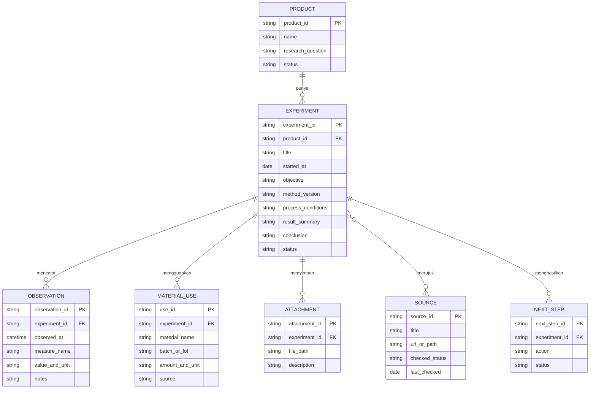

# Arsitektur GEMA RnD

**Tujuan:** bikin alat kerja digital sederhana untuk mengelola R&D lima produk: kopra edibel, cuka air kelapa, bioleather dari air kelapa, arang, dan briket. Dokumen ini sekaligus jadi pegangan saat vibe coding di Claude.

## 1. Bentuk paling sederhana

Mulai dari **buku catatan eksperimen digital** yang bisa dibuka di laptop/ponsel. Jangan mulai dari banyak agen, otomatisasi rumit, atau aplikasi besar.

```text
LO
 │ memberi instruksi / memasukkan catatan
 ▼
STUDIO HOME — proyek, eksperimen terbaru, tugas berikutnya
 ├── R&D Kopra Edibel
 ├── R&D Cuka Air Kelapa
 ├── R&D Bioleather
 ├── R&D Arang
 └── R&D Briket
      │
      ├── Eksperimen: tujuan, metode, variabel, hasil
      ├── Bahan dan alat
      ├── Foto, dokumen, dan sumber
      └── Kesimpulan dan langkah berikutnya

LIBRARY — SOP, referensi, formulir, catatan yang sudah dipelajari
SECOND BRAIN — indeks dan catatan lintas proyek
BACKUP — salinan terpisah untuk pemulihan
AGEN AI — bantu merapikan, mencari, dan membandingkan catatan
```

**Penting:** AI membantu mengatur dan menganalisis catatan. Jangan jadikan AI sebagai persetujuan keamanan pangan atau klaim bahwa produk aman dikonsumsi. Hasil pangan tetap perlu mengikuti standar dan pengujian yang sesuai.

## 2. PRD sederhana — aplikasi ini harus bisa apa?

### Pengguna
Lo sebagai peneliti/pemilik studio. Awalnya satu pengguna.

### Kebutuhan versi pertama
- Melihat lima proyek R&D di satu halaman.
- Membuat eksperimen baru dengan ID otomatis.
- Mencatat tujuan, tanggal, bahan/batch, alat, metode, kondisi proses, variabel, dan pengamatan.
- Menambahkan foto atau tautan file.
- Mencatat hasil, kesimpulan, masalah, dan eksperimen berikutnya.
- Mencari/menyaring eksperimen berdasarkan produk, tanggal, bahan, atau status.
- Menandai referensi sebagai belum diverifikasi, diperiksa, atau usang.
- Mengekspor atau mencadangkan catatan.

### Jangan dibuat dulu
Akun banyak pengguna, agen yang bekerja sendiri, integrasi alat lab, analitik rumit, publikasi otomatis, dan sistem resep yang mengklaim keamanan.

### Berhasil jika
Lo bisa mencatat eksperimen dalam beberapa menit, membandingkan percobaan lama, dan tahu alasan di balik keputusan berikutnya.

## 3. ARD sederhana — bagian-bagian aplikasi

```text
Halaman aplikasi
  ├─ Dashboard
  ├─ Proyek produk
  ├─ Formulir eksperimen
  ├─ Library sumber/SOP
  └─ Pencarian dan ekspor
        │
        ▼
Penyimpanan data eksperimen
        │
        ├─ Foto/file di penyimpanan file
        └─ Backup berkala di lokasi terpisah

Claude/agen: bantu merapikan dan membandingkan catatan; hasilnya selalu berupa draf untuk diperiksa lo.
```

Mulai dengan aplikasi lokal sederhana yang datanya gampang diekspor. Pilih database paling sederhana yang bisa digunakan oleh lingkungan Claude yang lo pakai; jangan memilih layanan cloud atau teknologi khusus sebelum tahu perlu. Hindari menyimpan kata sandi, token, atau data sensitif di catatan eksperimen.

## 4. ERD sederhana — data apa saja?



**Contoh:** satu proyek produk punya banyak eksperimen; satu eksperimen punya banyak pengamatan dan bahan. Catatan dibuat terpisah supaya hasil ulangan/percobaan tidak menimpa satu sama lain.

## 5. Cara mencatat supaya hasil eksperimen berguna

Untuk setiap percobaan, pakai pola ini:

1. **Pertanyaan:** hal apa yang mau diketahui?
2. **Tujuan:** hasil apa yang dicari?
3. **Metode:** langkah yang dilakukan dan versi prosedurnya.
4. **Bahan/batch:** bahan apa, dari mana, dan batch mana.
5. **Kondisi:** kondisi proses yang memang lo ukur/catat.
6. **Pengamatan:** apa yang dilihat/diukur, kapan, dan satuannya.
7. **Hasil:** apa yang terjadi, termasuk hasil yang tidak sesuai harapan.
8. **Kesimpulan sementara:** apa yang didukung data; apa yang belum diketahui.
9. **Berikutnya:** satu langkah atau pertanyaan lanjutan.

Catat juga siapa yang memasukkan data, tanggal, dan sumber. Jangan hapus hasil gagal—itu bagian dari pengetahuan studio.

## 6. Studio, agen, library, second brain, dan backup

- **Otak / dashboard:** tiga proyek, fokus saat ini, eksperimen terakhir, tindakan berikutnya.
- **Agen:** mulai dari satu asisten pencatat yang merapikan data ke format formulir. Nanti tambah analis perbandingan yang hanya menggunakan data tercatat dan selalu menunjukkan eksperimen sumbernya.
- **Library:** SOP, formulir, daftar alat, referensi dan sumber dengan tanggal/status pemeriksaan.
- **Sistem saraf:** alur `rencana → catat eksperimen → review catatan → simpulkan → rencanakan ulang`.
- **Second brain:** ringkasan temuan yang sudah dipelajari, keputusan, istilah, dan tautan ke eksperimen asal. Ini bukan tempat mengganti data mentah.
- **Backup:** salinan berkala terpisah dari perangkat utama. Pastikan foto/file ikut tercakup. Sesekali coba pulihkan cadangan, supaya tahu salinannya benar-benar bisa dipakai.

**Pemisahan penting:** data mentah eksperimen = rekaman asli; ringkasan second brain = pengetahuan turunan; backup = salinan untuk pemulihan. Jangan campur ketiganya.

## 7. Langkah kerja di Claude

### Sebelum mulai
1. Buka Claude dan buat Project/workspace khusus, misalnya **GEMA RnD**.
2. Jadikan dokumen ini spesifikasi proyek. Simpan juga di folder proyek agar Claude bisa membacanya lagi.
3. Minta Claude membangun versi terkecil: dashboard lima produk dan daftar/form eksperimen.
4. Setelah satu bagian selesai, jalankan aplikasinya dan coba masukkan satu eksperimen contoh.
5. Beri Claude satu perbaikan per pesan. Jangan minta semua fitur sekaligus.
6. Setelah alur catatan terasa cocok, baru tambah pencarian, ekspor, dan backup.
7. Simpan salinan project dan data di tempat berbeda. Jangan menunggu aplikasinya sempurna untuk mulai membuat backup.

### Kebiasaan prompt hemat
- Simpan instruksi tetap di Project Instructions atau file `CLAUDE.md` kalau Claude sedang bekerja di folder kode.
- Setelah instruksi tetap terpasang, prompt harian cukup menyebut perubahan yang diminta.
- Minta Claude memeriksa struktur/berkas yang ada dulu sebelum mengubahnya.
- Minta perubahan kecil dan jelaskan cara melihat hasilnya.
- Tempel pesan error lengkap hanya saat ada error.
- Hindari menempel ulang seluruh spesifikasi setiap giliran.

## 8. Prompt siap salin

### Prompt pertama — buat versi awal

```text
Baca spesifikasi GEMA RnD di file yang tersedia. Bangun aplikasi lokal sederhana untuk satu pengguna: dashboard lima produk (kopra edibel, cuka air kelapa, bioleather, arang, dan briket), daftar dan formulir eksperimen, pengamatan, bahan/batch, lampiran, kesimpulan, dan langkah berikutnya. Ikuti struktur data pada spesifikasi. Jangan menambah fitur di luar itu. Sebelum mengubah file, jelaskan singkat rencana dan file yang akan dibuat. Setelah selesai, beri tahu cara menjalankan dan mencoba aplikasi.
```

### Prompt perbaikan

```text
Perbaiki satu hal ini: [jelaskan masalah atau perubahan]. Periksa file yang relevan dulu, pertahankan fitur lain, lalu jelaskan cara memeriksa hasilnya.
```

### Prompt untuk pencatatan eksperimen

```text
Ubah catatan mentah di bawah menjadi draf catatan eksperimen. Jangan mengarang data. Tandai informasi yang belum ada sebagai "belum dicatat" dan pisahkan fakta, dugaan, serta pertanyaan lanjutan.
[Tempel catatan]
```

### Prompt untuk membandingkan eksperimen

```text
Bandingkan eksperimen [ID] dan [ID] memakai hanya catatan yang tersedia. Tampilkan perbedaan kondisi, hasil yang tercatat, hal yang belum tercatat, dan kesimpulan yang aman untuk ditarik. Sertakan ID eksperimen sebagai bukti; jangan menyatakan produk aman atau siap dikonsumsi.
```

## 9. Istilah teknis versi gampang

- **Dashboard:** halaman ringkasan.
- **Database:** tempat data disimpan dengan rapi supaya bisa dicari.
- **Frontend:** bagian aplikasi yang lo lihat dan klik.
- **Backend:** bagian yang menyimpan/mengatur data di belakang layar.
- **Local/lokal:** jalan dan/atau tersimpan di perangkat lo.
- **Prompt:** instruksi yang lo kasih ke Claude.
- **MVP:** versi paling kecil yang sudah berguna.
- **Versi metode:** penanda prosedur mana yang dipakai, supaya perubahan cara kerja tidak bikin hasil lama membingungkan.
- **Backup:** salinan untuk memulihkan data; bukan ringkasan dan bukan cuma tombol simpan.

## 10. Keputusan yang belum perlu dipaksa sekarang

- Apakah nanti aplikasi dipakai hanya di laptop atau juga ponsel?
- Apakah perlu dipakai offline?
- Apakah data harus sinkron antarperangkat?
- Apakah foto disimpan langsung atau cukup tautan?

Mulai dari cara paling sederhana yang bisa lo jalankan di Claude. Kunci keputusan ini setelah lo mencoba mencatat beberapa eksperimen nyata.


## 11. Riset teknis yang bisa dipercaya

Saat Claude membantu pertanyaan R&D, minta dia mencari sumber, bukan menjawab dari ingatan saja. Utamakan artikel ilmiah peer-reviewed, metode/standar resmi, regulator, dan sumber primer. Tinjauan ilmiah membantu menemukan topik, tetapi klaim penting perlu ditelusuri ke sumber aslinya.

Untuk setiap klaim penting, Claude harus memberi judul, penulis/lembaga, tahun, DOI/tautan, jenis sumber, kondisi yang diuji, keterbatasan, dan hubungan ke eksperimen GEMA RnD. Sumber harus dibuka dan diperiksa, bukan hanya diambil dari cuplikan pencarian. Untuk regulasi, periksa yurisdiksi yang relevan dan tanggal akses.

Claude wajib membedakan hasil satu eksperimen, replikasi, peer review, validasi pada kondisi yang mirip, uji produk akhir, dan persetujuan regulator. Jangan mengklaim produk aman dikonsumsi atau tervalidasi tanpa bukti yang sesuai. Kalau web tidak tersedia atau bukti kurang, sebutkan dengan jelas; jangan mengarang sitasi, DOI, atau hasil.

Tambahkan sumber ke library dengan metadata: judul, penulis/lembaga, tahun, jenis sumber, DOI/URL, tanggal akses, topik/produk, klaim yang didukung, metode/kondisi, keterbatasan, status pemeriksaan, dan eksperimen/keputusan terkait.

### Prompt riset singkat untuk Claude

```text
Riset pertanyaan ini dengan pencarian web. Gunakan sumber primer/otoritatif dan buka sumbernya untuk memeriksa klaim. Sajikan kesimpulan, kondisi yang diuji, keterbatasan, relevansi untuk GEMA RnD, serta judul/penulis/tahun/DOI atau URL dan tanggal akses. Bedakan bukti awal, hasil berulang, validasi pada kondisi mirip, uji produk akhir, dan persetujuan regulator. Jangan mengarang; jika sumber atau akses tidak cukup, katakan apa yang belum diketahui.
Pertanyaan: [tulis pertanyaan]
```

Simpan instruksi riset lengkap di `00-BACA-DULU-untuk-Claude.md` agar prompt harian tetap pendek.
