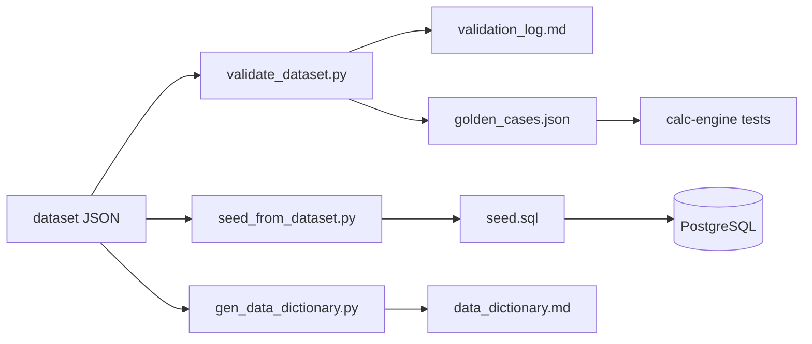

# architecture/ — gemasSTUDIO — Coco Inventory & R&D Lab

Paket arsitektur lengkap untuk membangun kalkulator dimensi & simulator ruang inventory (gudang + container) bagi **kelapa tua jambul, arang batok belah 2, kopra asalan, kopra edible**. Siap diserahkan ke Claude Code — mulai dari `HANDOFF.md`, lalu tempel prompt di `CLAUDE_CODE_PROMPT.md`.

- Dataset: **v1.0.4** · Dokumen arsitektur: **v1.0.0** · Tanggal: 2026-10-08
- Status validasi: **SEMUA CEK LULUS** — 105 PASS / 0 FAIL dataset · 18/18 uji integritas + 21/21 uji R&D di PostgreSQL 16 · seed termuat bersih · 17 golden cases · semua tautan valid

## Struktur

```
architecture/
├─ README.md                      ← Anda di sini
├─ HANDOFF.md                     ← Status, lembar dimensi per produk, batasan, definisi selesai
├─ CLAUDE_CODE_PROMPT.md          ← Prompt siap tempel: kickoff + fase M1–M4
├─ CLAUDE.md                      ← Instruksi kerja untuk Claude Code
├─ 00-research/
│  ├─ research_report.md          ← Jawaban riset: dimensi, berat, densitas 4 komoditas
│  └─ data/coconut_inventory_dataset.json   ← SUMBER KEBENARAN data (min/typ/max + sumber)
├─ 01-product/PRD.md              ← Product Requirements (persona, user story, FR/NFR, metrik)
├─ 02-architecture/
│  ├─ ARD.md                      ← Architecture Requirements & Design (C4, stack, API)
│  └─ adr/ADR-001..005            ← Architecture Decision Records
├─ 03-data/
│  ├─ ERD.md                      ← Entity Relationship Design (Mermaid) + aturan integritas
│  ├─ schema.sql                  ← DDL PostgreSQL 16 (teruji)
│  ├─ seed.sql                    ← DIBANGKITKAN dari dataset
│  └─ data_dictionary.md          ← Kamus data + katalog 45 parameter (dibangkitkan)
├─ 04-calculation/calculation_spec.md  ← Semua rumus, aturan rentang, warning, kontrak uji
├─ 05-ui-ux/ux_spec.md            ← IA, layar, status
├─ 06-design/                     ← Gaya "Punk Skate Lab": tokens.json, tailwind.preset.ts, globals.css, design_spec.md, mockups/
├─ 07-rnd/                        ← Modul R&D Lab: PRD_RnD.md, schema_rnd.sql, parameter_template.csv (diisi owner)
├─ logs/
│  ├─ CHANGELOG.md                ← Riwayat versi dataset & arsitektur
│  ├─ research_log.md             ← Jejak pencarian sumber
│  ├─ assumption_register.md      ← 19 asumsi berkeyakinan C + cara verifikasi
│  ├─ decision_log.md             ← Indeks 10 keputusan
│  ├─ risk_issue_log.md           ← 8 risiko + 11 isu (10 selesai)
│  ├─ field_verification_log.md   ← Protokol sampling lapangan
│  ├─ field_sampling_template.csv ← Template input sampling
│  ├─ traceability_matrix.md      ← Kebutuhan → desain → bukti uji
│  └─ validation_log.md           ← DIBANGKITKAN validator (jangan edit)
├─ scripts/
│  ├─ run_all_checks.sh           ← Jalankan semua validasi
│  ├─ validate_dataset.py         ← Validator + pembangkit golden cases
│  ├─ seed_from_dataset.py        ← JSON → seed.sql
│  └─ gen_data_dictionary.py      ← JSON → data_dictionary.md
└─ tests/
   ├─ schema_integrity_test.sql   ← 18 uji IR-01..IR-08
   ├─ rnd_integrity_test.sql      ← 21 uji modul R&D
   └─ fixtures/golden_cases.json  ← Kontrak hasil engine (DIBANGKITKAN)
```

## Alur Kerja Data



Ubah data **hanya** di `00-research/data/coconut_inventory_dataset.json`, naikkan `meta.version`, catat di `logs/CHANGELOG.md`, lalu jalankan:

```bash
bash scripts/run_all_checks.sh                                   # tanpa DB
PGURL=postgresql://postgres@localhost:5432/postgres bash scripts/run_all_checks.sh   # dengan uji DB
```

## Jawaban Cepat (typ)

| Komoditas | Dimensi unit | Berat unit | Densitas | 20ft |
|---|---|---|---|---|
| Kelapa jambul | 13,5 × 9,5 × 9,5 cm (badan 10,5 × Ø9,5) | 575 g | 483 lepas / 385 dalam karung | ≈ 22.500 butir |
| Arang batok belah 2 | Ø8,4 × dalam 4,4 cm, tebal 0,35 cm | 25 g | 85 lepas ⚠ / 475 bila dipecah | belah 2: volume-limited (uji dulu) · lump 12–13 t |
| Kopra asalan | 8 × 5 × 1,1 cm | 60 g | 500 curah / 440 karung | ≈ 13 t (prediksi, belum ada benchmark) |
| Kopra edible | cup Ø8 × 4 cm, tebal 1,2 | 80 g | 320 dalam karung | 10–11 t |

Detail & rentang min–max: `00-research/research_report.md`.
